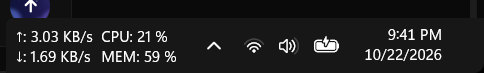

# Taskbar tray metrics (Windhawk mod)

A [Windhawk](https://windhawk.net/) mod that shows live system performance
metrics - upload/download network speed, CPU usage and RAM usage - directly
inside the **Windows 11 system tray**, to the left of the tray icons.

It is inspired by [TrafficMonitor](https://github.com/zh522136/TrafficMonitor)
and its classic floating "taskbar window", but instead of overlaying a
foreign window on the taskbar, the metrics are rendered **natively in the
taskbar's own XAML tree**, so they follow the theme, scale with DPI, and can
be styled with Windows 11 Taskbar Styler.



```
  ↑: 3.03 KB/s  CPU: 21 %
  ↓: 1.69 KB/s  MEM: 59 %        ^ [📶] [🔊]   9:41 PM
```

## Features

* **Two aligned columns** - each line is split at the first double space into
  a grid with a shared left column, so labels like `CPU:` / `MEM:` never
  misalign while the numbers change.
* **Hover tooltip** in the TrafficMonitor style: RAM used vs. total
  (GB and %), CPU usage and current network speeds.
* **Optional fixed width** so the taskbar does not resize every time a
  number changes (`Fixed width` setting).
* **Fully configurable display formats** with patterns: `%up%`, `%down%`,
  `%total%`, `%cpu%`, `%ram%`, `%ram_used%`, `%newline%`.
* **Position**: left of the overflow chevron or right of it.
* **Font/size/color** copied from neighboring tray icon text by default,
  with optional overrides (font size, family, color, margins).
* **Network adapter filtering** by name, or aggregate all non-loopback
  adapters.
* **Non-invasive**: nothing is persisted outside the hosting taskbar
  window; stop the mod and the block disappears.

### Styling from Windows 11 Taskbar Styler

The inserted element is a plain tray-area `StackPanel` named
`TaskbarTrayMetricsStack` containing a `Grid` named `MetricsTextGrid` with
up to four `TextBlock` cells, so you can style it with targets such as:

```
StackPanel#TaskbarTrayMetricsStack > TextBlock#MetricsTextBlock
StackPanel#TaskbarTrayMetricsStack > Grid#MetricsTextGrid > TextBlock#MetricsRight1
```

## Inspiration

This mod came from wanting TrafficMonitor's taskbar view - the compact
`↑ 3.03 KB/s  CPU: 21 %` / `↓ 1.69 KB/s  MEM: 59 %` readout with its RAM
tooltip - without an external always-on-top window. Credit to
[zhang (zh522136)](https://github.com/zh522136/TrafficMonitor) for
TrafficMonitor; if you want full-featured widgets, use TrafficMonitor. This
mod is the lightweight, native-XAML take on that idea.

## Installation

1. Install [Windhawk](https://windhawk.net/).
2. Open Windhawk → **Mods** → the `+` button → **Create a local mod** (or:
   Download mod from file).
3. Paste the contents of
   [`taskbar-tray-metrics.wh.cpp`](taskbar-tray-metrics.wh.cpp), give the mod
   the same id (`taskbar-tray-metrics`), then **Compile and install**.
4. The metrics appear in the tray within a couple of seconds (the
   network/CPU counters need two samples before rates become available).

## Compatibility (tested)

* **Windows 11 25H2/26H2 era builds (XAML taskbar)** - verified working,
  including enable/disable and taskbar reload cycles (the block re-inserts
  itself automatically).
* Verified coexistence (all running at the same time during testing) with:
  * Windows 11 Taskbar Styler
  * Taskbar Clock Customization
  * Taskbar height and icon size
  * Taskbar Volume Control
  * taskbar-auto-hide-when-maximized
  * taskbar-autohide-instant-show
  * taskbar-tray-system-icon-tweaks
* Requires the Windows 11 XAML taskbar; the classic Windows 10 taskbar is
  not supported.

## Troubleshooting

* Enable/disable the mod re-triggers the insertion; a full explorer reload
  also works.
* The mod writes a small diagnostic log to
  `%TEMP%\taskbar-tray-metrics-debug.log` when something unexpected happens
  - include it in bug reports.

## License

MIT - see [LICENSE](LICENSE).
